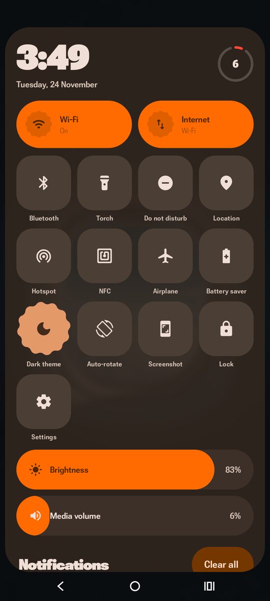

<p align="center">
  
</p>

<h3 align="center">A designer launcher for Android, built entirely on Material 3 Expressive.</h3>

<p align="center">
  
  
  
  
</p>

<p align="center">
  
  
  
  
  
</p>

---

Lumen replaces your home screen with one that moves, morphs and adapts. Every surface uses the
**Material 3 Expressive** shape catalogue, spring-based motion and variable **Roboto Flex** type, and
nearly every detail can be changed from inside the launcher.

## Highlights

### Home
- **Seven expressive clock faces**: Bold, Morph, Minimal, Breathe, Orbit, Tiles and Tall, with size, weight, width and colour controls.
- **Glance chips** for your next alarm and a wavy battery indicator, plus optional **weather**.
- A free-form **home grid** for apps and widgets, with drag to move, resize and remove.
- Built-in **Lumen widgets** (expressive clock, weather, date, battery ring) and full support for any app's widgets.
- A floating dock and a search pill with voice and Google Lens.
- Lumen's own **status bar** with signal, Wi-Fi, wavy battery ring and a notification count.

### Control panel
- Pull down anywhere for quick settings **detected from your device**: Wi-Fi, internet, Bluetooth, torch, Do Not Disturb, location, hotspot, NFC, airplane mode, battery saver, dark theme, rotation, screenshot and lock.
- Tiles that change shape when switched on, brightness and media sliders, and a live battery ring.
- **Notifications** grouped by app, with swipe to dismiss, inline reply, app actions, snooze and per-app settings.
- Adaptive layout: one column on phones, two columns in landscape and on tablets.

### Search
- A top result card, apps ranked by how often you use them, and **app shortcuts**.
- **Quick actions**: `timer 5 min`, `alarm 7:30 am`, `navigate to …`, `youtube …`.
- Calculator and unit conversion (`5 km in miles`, `30 c to f`).
- About **90 indexed system settings** with synonyms, plus a jump into Android's own settings search.
- Contacts with call and message buttons (opt-in), recent searches and Play Store fallback.

### Lock screen
- An optional cover above the secure lock screen with your clock face, charging progress, alarm, date and weather complications.
- A **Now Bar** media player and notifications as icons or expandable cards.
- Torch, camera, Do Not Disturb or voice shortcuts and a fingerprint button.
- **Security is unchanged**: unlocking is always handled by Android (fingerprint, face, PIN, pattern or password).

### Personalisation
- Around 50 options: grid size, icon shapes, themed icons, dock style, drawer sorting, hidden apps, gestures, motion bounce and speed, blur, colour intensity and custom accent colours.
- **72 app icons**: six calligraphy logo styles in Lumen's twelve solid colours, each with a monochrome layer for themed icons.
- Motion follows the M3 Expressive spring tokens, with predictive back and staggered entry.

## Requirements

| | |
|---|---|
| Android | 12 (API 31) or newer |
| Build | JDK 21, Android SDK 37, Gradle wrapper included |

## Build

```bash
git clone https://github.com/faizhussain7/Lumen.git
cd Lumen
./gradlew :app:assembleRelease
adb install -r app/build/outputs/apk/release/app-release.apk
```

Then press Home and choose **Lumen** → **Always**, or set it under
*Settings → Apps → Default apps → Home app*.

> The release build is signed with the local debug key so it installs straight away. Use your own
> signing configuration before distributing builds.

## Optional permissions

Lumen works without any of these. Each one is requested only when you turn on the feature that needs it.

| Feature | Permission or access | Why |
|---|---|---|
| Notification dots, panel notifications, Now Bar | Notification access | Read and act on notifications locally |
| Double-tap to lock, lock-screen cover, screenshot tile | Accessibility service "Lumen gestures" | Perform the lock, notifications and screenshot actions only |
| Brightness and rotation tiles | Modify system settings | Change those two settings |
| Do Not Disturb tile | Do Not Disturb access | Toggle Do Not Disturb |
| Weather | Approximate location and internet | Fetch the current weather from Open-Meteo |
| Contacts in search | Contacts | Show matching contacts on your device |

See [PRIVACY.md](PRIVACY.md) for exactly what is and isn't collected.

## Project structure

```
app/src/main/java/com/mfhapps/lumen/
├── Home.kt            Home screen, gestures, drawer and menus
├── Controls.kt        Control panel and device toggles
├── Notices.kt         Grouped, swipeable notification cards
├── Search.kt          Universal search, quick actions, conversions
├── SettingsIndex.kt   Indexed system settings with synonyms
├── LockCover.kt       Lock-screen cover
├── Clock.kt, ClockFaces.kt   Clock area and the seven clock faces
├── Workspace.kt       Home grid and widget hosting
├── Customise.kt       The Customise page
├── Expressive.kt, ExpressiveKit.kt   Theme, motion tokens and shared components
└── Logo.kt, LogoData.kt   Wordmark, app icons and icon switching
```

## Contributing

Contributions are welcome. Please read [CONTRIBUTING.md](CONTRIBUTING.md) and the
[Code of Conduct](CODE_OF_CONDUCT.md) first. Report security issues as described in [SECURITY.md](SECURITY.md).

## Credits

- [Material 3 Expressive](https://m3.material.io/) design language and shape catalogue by Google.
- [Roboto Flex](https://github.com/googlefonts/roboto-flex), plus the script typefaces used for the logo
  outlines (Great Vibes, Parisienne, Alex Brush, Pinyon Script, Allura and Monsieur La Doulaise), all under the SIL Open Font License.
- Material Symbols icons through AndroidX, under the Apache License 2.0.
- [Weather data by Open-Meteo.com](https://open-meteo.com/), under CC BY 4.0.

Full third-party notices are in [NOTICE](NOTICE) and [licenses/](licenses).

## License

Lumen is released under the [Apache License 2.0](LICENSE).

Lumen is an independent project and is not affiliated with or endorsed by Google. Android and Material Design are trademarks of Google LLC.
