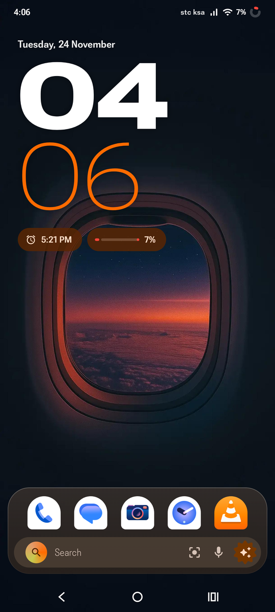
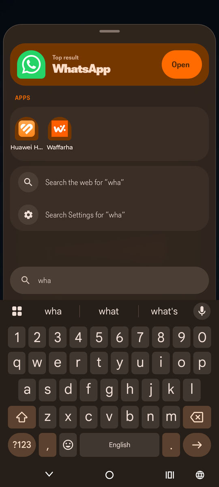
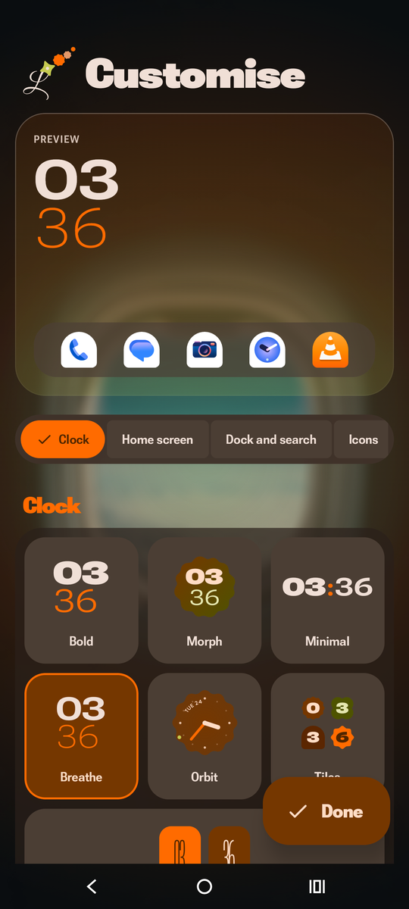
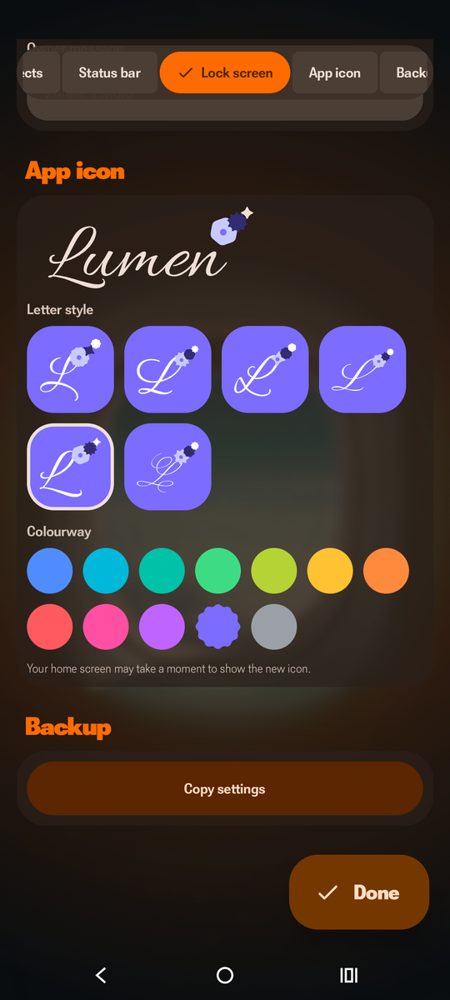

<div align="center">


### A designer launcher for Android, built entirely on Material 3 Expressive.

Shapes that morph, motion driven by springs, and variable type, all on your home screen.

<p>
  
  
  
</p>
<p>
  <a href="LICENSE"></a>
  <a href="https://github.com/faizhussain7/Lumen/stargazers"></a>
  <a href="https://github.com/faizhussain7/Lumen/commits/main"></a>
  
  
</p>

**[Features](#-features)** · **[Install](#-install)** · **[Permissions](#-permissions)** · **[Build](#-build-from-source)** · **[Contributing](#-contributing)** · **[Changelog](CHANGELOG.md)**

<br>







<sub>Home · Control panel · Search · Customise · App icons</sub>

</div>

<br>

## ✦ Why Lumen

<table>
<tr>
<td width="33%" valign="top">

**Expressive throughout**<br>
Every surface uses the M3 Expressive shape catalogue. Tiles morph when you switch them on, and the motion follows Material's spring tokens.

</td>
<td width="33%" valign="top">

**Private by design**<br>
No accounts, analytics or ads. Everything stays on your phone. The only network calls are for weather, if you turn it on.

</td>
<td width="33%" valign="top">

**Yours to shape**<br>
Around 50 options, icon packs, folders, up to five pages, 72 app icons and a backup you can restore. Change almost anything without leaving the launcher.

</td>
</tr>
</table>

## ✦ Features

<details open>
<summary><b>🏠 Home</b></summary>
<br>

- **Seven expressive clock faces**: Bold, Morph, Minimal, Breathe, Orbit, Tiles and Tall. Each has size, weight, width and colour controls.
- **Up to five home pages** in a free-form grid for apps, widgets and **folders**. Drag to move, resize and remove.
- **Folders**: drop one app onto another to make a folder. Rename it, take apps out, or move it into the dock.
- Built-in **Lumen widgets** (clock, weather, date and battery ring), and any app's widgets through a carousel picker.
- **Glance chips** for your next alarm and battery, and **weather** from your location or a city you choose.
- A floating dock, a search pill with voice and Google Lens, and Lumen's own status bar.

</details>

<details open>
<summary><b>🎛️ Control panel</b></summary>
<br>

- Pull down anywhere. Quick settings are **detected from your device**: Wi-Fi, Bluetooth, torch, Do Not Disturb, location, hotspot, NFC, airplane mode, battery saver, dark theme, rotation, screenshot and lock.
- Tiles change shape when they're on. There are sliders for brightness and media, and a live battery ring.
- **Notifications** are grouped by app. Swipe to dismiss, or reply inline, use app actions, snooze, and open per-app settings.
- One column on phones, and two in landscape and on tablets.

</details>

<details open>
<summary><b>🔍 Search</b></summary>
<br>

- A top result card, apps ranked by how often you use them, **app shortcuts** and recent searches.
- **Quick actions**: `timer 5 min`, `alarm 7:30 am`, `navigate to …`, `youtube …`.
- **Calculator** and **unit conversion**, for example `5 km in miles` or `30 c to f`.
- About **90 indexed system settings** with synonyms, and a jump into Android's own settings search.
- Contacts with call and message buttons (opt-in), and the Play Store as a fallback.

</details>

<details open>
<summary><b>🔒 Lock screen</b></summary>
<br>

- An optional cover above the secure lock screen. It shows your clock face, charging progress, alarm, date and weather.
- A **Now Bar** media player, and notifications shown as icons or as cards you can expand.
- Shortcuts for torch, camera, Do Not Disturb or voice.
- **Security is unchanged.** Android always handles unlocking (fingerprint, face, PIN, pattern or password).

</details>

<details open>
<summary><b>🎨 Personalisation</b></summary>
<br>

- **Icon packs** in the ADW, Nova, GO, Apex, Teslacoil or Lawnchair formats, plus themed icons and several icon shapes.
- Grid size, dock style, drawer sorting, hidden apps, gestures, blur, colour intensity and custom accent colours.
- Motion **bounce and speed** controls, with predictive back and staggered entry.
- **72 app icons**: six calligraphy logo styles in twelve solid colours, each with a monochrome layer for themed icons.
- **Back up and restore** all your settings as a single file.

</details>

<details open>
<summary><b>🌍 Languages</b></summary>
<br>

| English | Español | Français | Deutsch | العربية | हिन्दी |
|:-:|:-:|:-:|:-:|:-:|:-:|
| ✓ | ✓ | ✓ | ✓ | ✓ RTL | ✓ |

On Android 13 and newer, you can set Lumen's language separately under *Settings → Apps → Lumen → Language*.

</details>

## ✦ Install

1. [Build the APK from source](#-build-from-source). Prebuilt releases are coming soon.
2. Press **Home** and choose **Lumen → Always**. You can also go to *Settings → Apps → Default apps → Home app*.
3. Long-press the home screen, open **Customise**, and make it yours.

Lumen needs **Android 12 (API 31)** or newer.

## ✦ Permissions

Lumen works without any of these. Each one is asked for only when you turn on the feature that needs it.

| Feature | Access | Why |
|---|---|---|
| Notification dots, panel notifications, Now Bar | Notification access | To read and act on notifications on the device |
| Double-tap to lock, lock-screen cover, screenshot tile | Accessibility service "Lumen gestures" | Only to lock, open notifications and take screenshots |
| Brightness and rotation tiles | Modify system settings | To change those two settings |
| Do Not Disturb tile | Do Not Disturb access | To turn Do Not Disturb on and off |
| Weather | Approximate location *(optional)* and internet | To get weather from Open-Meteo. You can pick a city instead of sharing location |
| Contacts in search | Contacts | To show matching contacts stored on the device |

[PRIVACY.md](PRIVACY.md) sets out exactly what is and isn't collected.

## ✦ Build from source

```bash
git clone https://github.com/faizhussain7/Lumen.git
cd Lumen
./gradlew :app:assembleRelease          # build
./gradlew :app:testDebugUnitTest        # run unit tests
adb install -r app/build/outputs/apk/release/app-release.apk
```

You need JDK 21 and Android SDK 37. The Gradle wrapper is included.

> [!NOTE]
> Local release builds are signed with the debug key, so they install straight away. Use your own signing configuration before you distribute a build.

<details>
<summary><b>Project structure</b></summary>
<br>

```
app/src/main/java/com/mfhapps/lumen/
├── Home.kt                 Home screen, gestures, drawer and menus
├── Workspace.kt            Home pages, grid, folders and widget hosting
├── Controls.kt             Control panel and device toggles
├── Notices.kt              Grouped, swipeable notification cards
├── Search.kt               Universal search, quick actions, conversions
├── SettingsIndex.kt        Indexed system settings with synonyms
├── LockCover.kt            Lock-screen cover
├── Clock.kt, ClockFaces.kt Clock area and the seven clock faces
├── Weather.kt              Open-Meteo forecast and city search
├── Apps.kt, Icons.kt       App list, icon rendering and caching
├── IconPacks.kt            Icon pack discovery and appfilter parsing
├── Customise.kt            The Customise page
├── Prefs.kt                Settings, backup and restore
├── Expressive.kt, ExpressiveKit.kt  Theme, motion tokens and shared components
└── Logo.kt, LogoData.kt    Wordmark, app icons and icon switching
```

**Built with:** Kotlin · Jetpack Compose · Material 3 Expressive · AndroidX Graphics Shapes · Roboto Flex

</details>

## ✦ Contributing

Contributions are welcome, including bug reports, translations, icon pack fixes and features.
Please read [CONTRIBUTING.md](CONTRIBUTING.md) and the [Code of Conduct](CODE_OF_CONDUCT.md) first.
To report a security issue, follow [SECURITY.md](SECURITY.md).

To add a language, copy `app/src/main/res/values/strings.xml` into `values-<code>/`, translate it, and add the locale to `res/xml/locales_config.xml`.

## ✦ Credits

- [Material 3 Expressive](https://m3.material.io/), the design language and shape catalogue by Google.
- [Roboto Flex](https://github.com/googlefonts/roboto-flex), and the script typefaces behind the logo outlines: Great Vibes, Parisienne, Alex Brush, Pinyon Script, Allura and Monsieur La Doulaise. All are under the SIL Open Font License.
- Material Symbols icons through AndroidX, under the Apache License 2.0.
- [Weather data by Open-Meteo.com](https://open-meteo.com/), under CC BY 4.0.

The full third-party notices are in [NOTICE](NOTICE) and [licenses/](licenses).

## ✦ License

Lumen is released under the [Apache License 2.0](LICENSE).

<sub>Lumen is an independent project. It is not affiliated with or endorsed by Google. Android and Material Design are trademarks of Google LLC.</sub>

<div align="center"><br><b>If Lumen brightens your home screen, a ⭐ helps others find it.</b></div>
